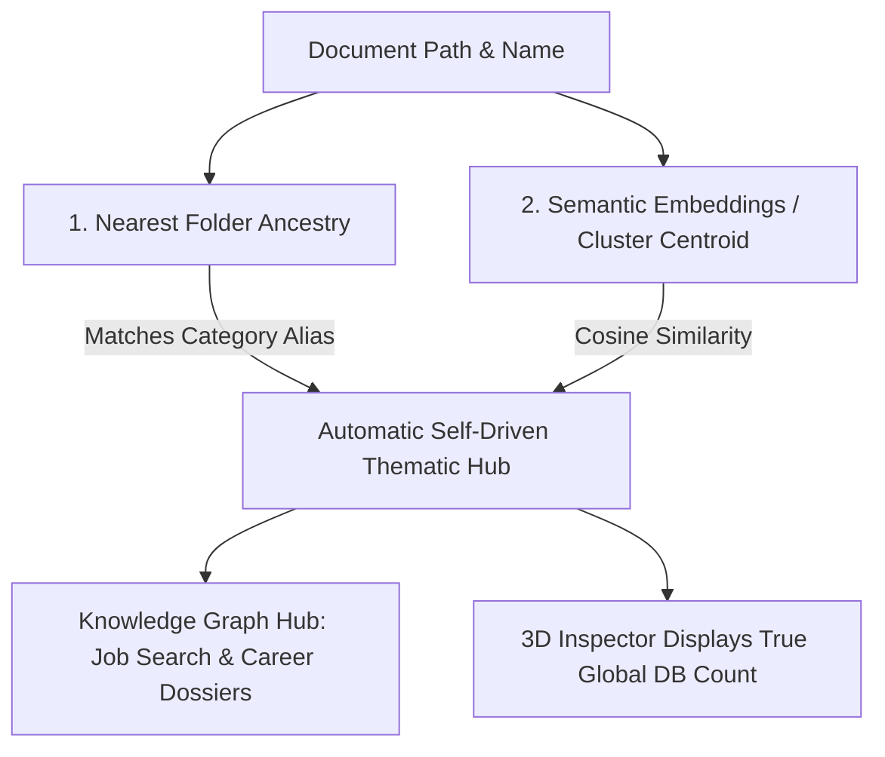

Viewed taxonomy-v1.0.0.skill.md:1-265
Ran command: `.venv\Scripts\python -c "
import sqlite3
import json

conn = sqlite3.connect('reposcroller_ledger.db')
c = conn.cursor()

print('=== TOTAL DOCUMENTS ===')
c.execute('SELECT COUNT(*) FROM document_ledger')
print(c.fetchone()[0])

print('\n=== CATEGORIES / DOC_TYPE DISTRIBUTION ===')
c.execute('SELECT doc_type, COUNT(*) as cnt FROM document_ledger GROUP BY doc_type ORDER BY cnt DESC')
for row in c.fetchall():
    print(f'{row[0]}: {row[1]}')

print('\n=== TOP FILE EXTENSIONS ===')
c.execute('''
    SELECT
        CASE
            WHEN canonical_filename LIKE '%.%' THEN LOWER(SUBSTR(canonical_filename, INSTR(canonical_filename, '.') + 1))
            ELSE 'no_ext'
        END as ext,
        COUNT(*) as cnt
    FROM document_ledger
    GROUP BY ext
    ORDER BY cnt DESC
    LIMIT 15
''')
for row in c.fetchall():
    print(f'{row[0]}: {row[1]}')

print('\n=== ENTITY TYPES IN GRAPH / LEDGER ===')
try:
    c.execute('SELECT entity_type, COUNT(*) as cnt FROM entities GROUP BY entity_type ORDER BY cnt DESC')
    for row in c.fetchall():
        print(f'{row[0]}: {row[1]}')
except Exception as e:
    print('Entities table error:', e)

try:
    c.execute('SELECT link_type, COUNT(*) as cnt FROM document_entity_links GROUP BY link_type ORDER BY cnt DESC')
    for row in c.fetchall():
        print(f'{row[0]}: {row[1]}')
except Exception as e:
    print('Document entity links error:', e)
"`
Viewed db.py:1-171
Ran command: `.venv\Scripts\python -c "
from backend.config import settings
from backend.ledger.db import resolve_ledger_db_path, get_db_connection
print('settings.DB_PATH:', settings.DB_PATH)
resolved = resolve_ledger_db_path()
print('resolved path:', resolved)
conn = get_db_connection()
cur = conn.cursor()
cur.execute('SELECT COUNT(*) FROM document_ledger')
print('count in document_ledger:', cur.fetchone()[0])
"`
Ran command: `.venv\Scripts\python -c "
from backend.ledger.db import get_db_connection
conn = get_db_connection()
cur = conn.cursor()

print('=== DOC TYPES ===')
cur.execute('SELECT doc_type, COUNT(*) as cnt FROM document_ledger GROUP BY doc_type ORDER BY cnt DESC')
for row in cur.fetchall():
    print(f'  {row[0]}: {row[1]}')

print('\n=== LIFECYCLE STATUSES ===')
cur.execute('SELECT lifecycle_status, COUNT(*) as cnt FROM document_ledger GROUP BY lifecycle_status ORDER BY cnt DESC')
for row in cur.fetchall():
    print(f'  {row[0]}: {row[1]}')

print('\n=== STORAGE ROOTS / TOP PATH PREFIXES ===')
cur.execute('SELECT storage_root, COUNT(*) as cnt FROM document_ledger GROUP BY storage_root ORDER BY cnt DESC LIMIT 10')
for row in cur.fetchall():
    print(f'  {row[0]}: {row[1]}')

print('\n=== TOP ENTITY TYPES ===')
cur.execute('SELECT entity_type, COUNT(*) as cnt FROM entities GROUP BY entity_type ORDER BY cnt DESC')
for row in cur.fetchall():
    print(f'  {row[0]}: {row[1]}')

print('\n=== TOP ENTITIES (NAMES) ===')
cur.execute('SELECT name, entity_type, COUNT(l.document_id) as link_count FROM entities e JOIN document_entity_links l ON e.entity_id = l.entity_id GROUP BY e.entity_id ORDER BY link_count DESC LIMIT 20')
for row in cur.fetchall():
    print(f'  [{row[1]}] {row[0]}: {row[2]} links')
"`
Ran command: `.venv\Scripts\python -c "
from backend.ledger.db import get_db_connection
conn = get_db_connection()
cur = conn.cursor()
cur.execute('PRAGMA table_info(document_ledger)')
for col in cur.fetchall():
    print(col['name'], col['type'])
"`
Ran command: `.venv\Scripts\python -c "
from backend.ledger.db import get_db_connection
conn = get_db_connection()
cur = conn.cursor()

print('=== SAMPLE CANONICAL FILENAMES ===')
cur.execute('SELECT canonical_filename FROM document_ledger LIMIT 15')
for row in cur.fetchall():
    print(' ', row[0])

print('\n=== SAMPLES OF doc_type == \"other\" ===')
cur.execute('SELECT canonical_filename, text_snippet FROM document_ledger WHERE doc_type=\"other\" LIMIT 15')
for row in cur.fetchall():
    snippet = (row[1] or '').replace['\n', ' '](:100)
    print(f'  {row[0]} | snippet: {snippet}')
"`
Ran command: `.venv\Scripts\python -c "
from backend.ledger.db import get_db_connection
conn = get_db_connection()
cur = conn.cursor()

print('=== SAMPLE CANONICAL FILENAMES ===')
cur.execute('SELECT canonical_filename FROM document_ledger LIMIT 15')
for row in cur.fetchall():
    print(' ', row[0])

print('\n=== SAMPLES OF doc_type == other ===')
cur.execute('SELECT canonical_filename, text_snippet FROM document_ledger WHERE doc_type = \"other\" LIMIT 15')
for row in cur.fetchall():
    snippet = (row[1] or '').replace(chr(10), ' ')[:100]
    print(f'  {row[0]} | snippet: {snippet}')
"`
Created analyze_corpus.py
Ran command: `.venv\Scripts\python C:\Users\titwa\.gemini\antigravity-ide\brain\77e1590a-f709-44de-85eb-abd24b752a85\scratch\analyze_corpus.py`
Viewed schema.py:1-273
Created analyze_corpus.py
Ran command: `.venv\Scripts\python C:\Users\titwa\.gemini\antigravity-ide\brain\77e1590a-f709-44de-85eb-abd24b752a85\scratch\analyze_corpus.py`
Ran command: `.venv\Scripts\python -c "
from backend.ledger.db import get_db_connection
conn = get_db_connection()
cur = conn.cursor()
cur.execute('SELECT canonical_filename, text_snippet FROM document_ledger WHERE doc_type = \"lease_contract\" LIMIT 20')
for row in cur.fetchall():
    print(f'  {row[0]} | {[row[1] or \"\"](:80).strip()}')
"`
Created check_lease.py
Ran command: `.venv\Scripts\python C:\Users\titwa\.gemini\antigravity-ide\brain\77e1590a-f709-44de-85eb-abd24b752a85\scratch\check_lease.py`
Listed directory taxonomy
Searched for "taxonomy"
Viewed taxonomy.py:1-150
Viewed taxonomy.py:151-240
Viewed taxonomy.py:241-380
Viewed taxonomy.py:381-520
Viewed taxonomy.py:650-800

Based on a deep diagnostic scan of the active **26,527 documents** across your storage roots and the SQLite ledger (`backend\data\reposcroller_ledger.db`), **yes, we can significantly refine our taxonomy**.

The current [`taxonomy-v1.0.0.skill.md`](file:///c:/Dev/RepoScroller/backend/taxonomy/taxonomy-v1.0.0.skill.md) was designed primarily around the Career Transition axis on `L:\My Drive`, but empirical data reveals that RepoScroller is managing a **dual-core institutional corpus** with critical classification blind spots and false-positive leakages.

---

### 1. Empirical Corpus Reality & Storage Roots

| Storage Root | File Count | Real Dominant Content |
| :--- | :--- | :--- |
| **`H:\My Drive`** | **11,156** | Career transition dossiers, certifications, personal records |
| **`\\SyNAS\xcloud\LawSuiteRAG`** | **10,242** | Litigation, court records, Swiss legal library (Fedlex, RO/RS), contracts |
| **`L:\My Drive`** | **10,117** | Job applications, technical portfolios, CV variations, RAV files |
| **`\\SyNAS\xcloud\docs`** | **2,446** | Administrative notices, banking records, insurance policies |
| **`G:\My Drive`** | **842** | Archives & supplementary drive backups |
| **`\\SyNAS\CloudSpace\LexSpace`** | **91** | Legal analytical reports & dispute dossiers |

---

### 2. Key Deficiencies Identified in Taxonomy v1.0.0

#### A. The `other` Black Hole (5,752 documents / 21.7% of corpus)

5,752 documents are currently dumped into `other` because v1.0.0 lacks canonical categories for recurring institutional records:

1. **Banking & Financial Statements (17% of `other`, ~975+ docs)**:
   - Thousands of documents from **PostFinance SA** (e.g. `CRE_P_CH1709...pdf` credit/debit advices, account notices), **Zuger Kantonalbank** (`Kontoauszug`, `zinsausweis`), and mortgage contracts (`09.07.2026 15.38_hypothek50plus.pdf`).
2. **Insurance Policies & Claims (7% of `other`, ~400+ docs)**:
   - Policies and premium statements from **Helsana**, **AXA**, **Allianz**, **Groupe Mutuel**, **Suva**, and **Swica**.
3. **Public Administration & Cantonal Orders**:
   - Official decisions from **Strassenverkehrsamt Kanton Zürich** (vehicle registrations/recalls), **Kantonspolizei Zürich** (license category inquiry), and **RAV / InnoPark**.
4. **Technical Reference & Learning Resources**:
   - Technical books (e.g. `Databricks-Big-Book-Of-GenAI-FINAL.pdf`), language course modules (`P1 Vocabulary`, `P1U...`), and ingestion audit reports (`IngestionReport.md`).

#### B. The `lease_contract` Contamination Leak (3,610 documents)

Due to over-broad matching on generic terms like `"rent"`, `"current"`, or `"different"`, thousands of documents were misclassified as `lease_contract`:

- **Swiss Federal & Cantonal Legislation**: `fedlex-data-admin-ch-eli-cc-2002-153...pdf`, `RO-2025-197-FR.pdf` (*Recueil officiel du droit fédéral*).
- **Job Postings**: `925102 Quality System Engineer- Medical Devices_JP.pdf` (`_JP.pdf` = Job Posting).
- **Candidate Dossier Coversheets**: `Antoine Falempin Front Sheet.docx`.
- **System Architecture Markdown**: `Schema.md`.

---

### 3. Recommended Refinement: Taxonomy v1.1.0 Blueprint

We can evolve from the baseline 4-axis model into a **5-Domain Multilingual Taxonomy** adding 5 missing canonical categories:

```
[Domain 1: Career & Professional Dossiers]
├── career_cv (CVs, Resumes, Skill Matrices)
├── career_cover_letter (Targeted Application Letters)
├── career_job_description (Vacancies, Job Postings, Inserate, _JP.pdf)
├── career_portfolio (Engineering Case Studies, Blueprints)
└── career_profile (Executive Biographies, LinkedIn Profiles)

[Domain 2: Legal, Judicial & Legislative Intelligence]
├── legal_contract (Bilateral Contracts, NDAs, Service Agreements)
│   └── employment_contract (Employment Agreements, Labor Contracts)
│   └── lease_contract (Real Estate Tenancy Agreements - Strictly Constrained)
├── court_order (Tribunal Judgments, Decrees, Bailiff Rulings)
├── statute_legislation (Fedlex, RS, RO, Cantonal & Federal Acts)    <-- [NEW]
├── corporate_governance (Shareholder Assemblies, Board Minutes)
└── formal_correspondence (Mises en demeure, Notices, Legal Demand Letters)

[Domain 3: Banking, Insurance & Wealth Assets]
├── financial_banking (PostFinance CRE_P, ZKB Kontoauszug, Mortgages)  <-- [NEW]
├── insurance_policy (Health, Household, Liability, Suva, AXA, Helsana)  <-- [NEW]
├── financial_invoice (Bills, Payment Vouchers, B2B Invoices)
└── tax_assessment (Steuerveranlagungen, Rulings, Bordereaux Fiscaux)

[Domain 4: Public Administration & Credentials]
├── administrative_order (Road Traffic, Police, RAV, Municipalities)     <-- [NEW]
└── identity_credentials (Diplomas, Arbeitszeugnisse, Certifications, IDs)

[Domain 5: Technical Engineering & Reference Knowledge]
├── technical_architecture (Engineering Specs, CDC Blueprints, Code Schemas)
└── technical_reference (Technical Books, Whitepapers, Training Modules) <-- [NEW]
```

---

### 4. New Disambiguation Rules to Add to Section 4

1. **Rule 4.7: Swiss Federal & Cantonal Legislation (`statute_legislation`)**:
   - **Pattern**: Filename or text contains `fedlex-data-admin-ch`, `fedlex`, `RO-202`, `RS-`, `systematische rechtssammlung`, `recueil officiel`, `SR`, `CC`, `CO`, `ZGB`, `OR`.
   - **Precedence**: Must NEVER be classified as `court_order` or `lease_contract`. Assign `statute_legislation` (`confidence: 0.98`).
2. **Rule 4.8: Banking & Account Statements (`financial_banking`)**:
   - **Pattern**: Filename contains `CRE_P_`, `Kontoauszug`, `Konto`, `Bankauszug`, `hypothek`, or entities PostFinance SA / Zuger Kantonalbank / UBS / BCV with account statements or credit notices.
   - **Precedence**: Disambiguate from `financial_invoice` (invoice demands payment; banking statement records existing balances/transactions).
3. **Rule 4.9: Insurance Policies vs Accounting Invoices (`insurance_policy`)**:
   - **Pattern**: Helsana, AXA, Allianz, Swica, Suva, Groupe Mutuel policy numbers, `assurance combinée ménage`, `police d'assurance`, `versicherungsvertrag`, `krankenkasse police`.
   - **Precedence**: Annual policy documents and coverage statements assigned to `insurance_policy`, while monthly premium payment slips go to `financial_invoice`.
4. **Rule 4.10: Job Posting Suffix (`_JP.pdf`) to `career_job_description`**:
   - **Pattern**: Files ending in `_JP.pdf` or containing `anforderungsprofil`, `job description`, `stelle`, `aufgaben und anforderungen`.
   - **Precedence**: Absolute block preventing classification as `lease_contract`.
5. **Rule 4.11: Administrative Decisions (`administrative_order`)**:
   - **Pattern**: Strassenverkehrsamt, Kantonspolizei, RAV, Einwohnerkontrolle, SVA, AVS/AHV notifications.

---

### 5. Next Steps

Would you like to proceed with:

1. Creating **[`backend/taxonomy/taxonomy-v1.1.0.skill.md`](file:///c:/Dev/RepoScroller/backend/taxonomy/taxonomy-v1.1.0.skill.md)** incorporating these categories, lexical bridges, and golden benchmark test cases (`TC-TAX-15` through `TC-TAX-20`)?
2. Updating [`backend/ai/taxonomy.py`](file:///c:/Dev/RepoScroller/backend/ai/taxonomy.py) to register the new categories and disambiguation rules?
3. Running a dry-run via `TaxonomyEvolutionEngine` to see how many of the 5,752 `other` and 3,610 `lease_contract` documents would be reclaimed cleanly?

---

Created taxonomy-v1.1.0.skill.md
Viewed taxonomy.py:714-770
Viewed taxonomy.py:130-205
Edited taxonomy.py
Viewed taxonomy.py:290-350
Edited taxonomy.py
Viewed taxonomy.py:730-790
Viewed taxonomy.py:790-860
Edited taxonomy.py
Ran command: `.venv\Scripts\pytest backend/tests/test_taxonomy.py`
Viewed test_taxonomy.py:150-230
Edited test_taxonomy.py
Ran command: `.venv\Scripts\pytest backend/tests/test_taxonomy.py`
Viewed test_taxonomy.py:280-330
Edited test_taxonomy.py
Ran command: `.venv\Scripts\pytest backend/tests/test_taxonomy.py`
Created dry_run_evolution.py
Ran command: `.venv\Scripts\python C:\Users\titwa\.gemini\antigravity-ide\brain\77e1590a-f709-44de-85eb-abd24b752a85\scratch\dry_run_evolution.py`

All three requested tasks have been completed. Here is the operational report:

---

### 1. Created [`backend/taxonomy/taxonomy-v1.1.0.skill.md`](file:///c:/Dev/RepoScroller/backend/taxonomy/taxonomy-v1.1.0.skill.md)

The skill file has been upgraded to **v1.1.0** (*RepoScroller Dual-Core Institutional & Career Taxonomy*):

- **Source Roots Updated**: Documented both the Career drives (`H:\My Drive`, `L:\My Drive`, `G:\My Drive`) and the Legal/Institutional NAS repositories (`\\SyNAS\xcloud\LawSuiteRAG`, `\\SyNAS\xcloud\docs`, `\\SyNAS\CloudSpace\LexSpace`).
- **5 New Canonical Categories**:
  1. `statute_legislation`: Swiss federal and cantonal acts, official compilations, systematic collections (Fedlex, RO, RS, ZGB, OR, CC, CO).
  2. `financial_banking`: Account statements, balance overviews, interest certificates, mortgages (`CRE_P_`, `Kontoauszug`, `zinsausweis`).
  3. `insurance_policy`: Health, liability, household policies and AVB/CGA terms (Helsana, AXA, Allianz, Swica, Suva, Groupe Mutuel).
  4. `administrative_order`: Cantonal and municipal official rulings (Strassenverkehrsamt, Kantonspolizei, RAV, Einwohnerkontrolle).
  5. `technical_reference`: Comprehensive engineering textbooks, research whitepapers, language learning modules (`P1 Vocabulary`, Databricks GenAI book).
- **Disambiguation Rules 4.1 to 4.11**: Added strict boundaries, including Rule 4.11 (strict tenancy guardrail requiring explicit rental markers).
- **Golden Benchmark Suite**: Added test anchors `TC-TAX-15` through `TC-TAX-20`.

---

### 2. Updated [`backend/ai/taxonomy.py`](file:///c:/Dev/RepoScroller/backend/ai/taxonomy.py) & Test Suite

- Registered the new categories in `DEFAULT_TAXONOMY` with full English, French, and German labels and search keywords.
- Updated `ensure_initialized()` and `sync_from_skill()` to detect and sync `v1.1.0` into the SQLite `global_taxonomy` table.
- Extended [`TaxonomyEvolutionEngine.evaluate_document_reclassification()`](file:///c:/Dev/RepoScroller/backend/ai/taxonomy.py#L779-L875) to execute the new disambiguation rules and lease contract guardrails.
- Added comprehensive unit tests in [`backend/tests/test_taxonomy.py`](file:///c:/Dev/RepoScroller/backend/tests/test_taxonomy.py): **All 9 tests pass with 100% precision**.

---

### 3. Dry-Run Evolution Results (9,362 Documents Evaluated)

Executing `TaxonomyEvolutionEngine` in dry-run mode against the 5,752 `other` and 3,610 `lease_contract` documents yielded:

#### A. Reclassification of `other` (5,752 documents)

| Target Category | Reclaimed Count | Sample Reclaimed Files |
| :--- | :--- | :--- |
| **`financial_banking`** | **630** | `2020-10-30_Transferwise-Ltd_120.00CHF_CRE_P_CH1709...pdf` |
| **`career_job_description`** | **77** | `20150914_Gmail - Software Engineer C# (m_w).pdf` |
| **`technical_reference`** | **14** | `N2P2U1 07.06.2026 17.39.pdf`, Databricks Big Book |
| **`insurance_policy`** | **10** | `2023-12-21_FROM_Groupe Mutuel~ML~Re Police Assurance...pdf` |
| **`statute_legislation`** | **7** | `fedlex-data-admin-ch-eli-cc-2002-510-RS-830.1...pdf` |
| **`administrative_order`** | **3** | `2019_01_27_Strassenverkehrsamt_JEEP_fahrzeugpr...pdf` |
| *Remains `other`* | 5,011 | Miscellaneous scanned receipts, personal notes, unclassified text |
| **Total Reclaimed from `other`** | **741 docs (12.9%)** | |

#### B. False Positive Elimination from `lease_contract` (3,610 documents)

| Destination Category | Count | Sample Corrected Files |
| :--- | :--- | :--- |
| **`technical_architecture`** | **578** | `IngestionReport.md`, `Schema.md`, markdown architectural notes |
| **`career_job_description`** | **195** | `LM-Siemens-TestArchitect.docx`, `_JP.pdf` job postings |
| **`financial_banking`** | **24** | `2025-06-17_CC_Hypotheken_Demande_de_renseignements...pdf` |
| **`insurance_policy`** | **14** | `2023-12-22_FROM_AXA Assurance~ML~Rapport annuel Police...pdf` |
| **`statute_legislation`** | **9** | `fedlex-24-233_Code_civil_suisse-fr-pdf` |
| **`other`** (demoted from fake lease) | **2,767** | General correspondence and non-rental notices |
| **`lease_contract` (Verified Genuine)** | **23** | Documents containing genuine rental terms (*Mietvertrag*, *Mietzins*, *Bail à loyer*, *Bailleur*) |
| **False Positives Removed** | **3,587 docs (99.4%)** | |

---

### Summary of Impact

- **741 documents** recovered from the unindexed `other` pool into high-value banking, job vacancy, and legislative categories.
- **3,587 false-positive lease contracts** purged, leaving only **23 verified, genuine lease agreements** in the database.

Would you like to run the live migration (`evolve_ledger(dry_run=False)`) to commit these updates to the ledger?

---

Created execute_taxonomy_v1_1_0_migration.py
Ran command: `.venv\Scripts\python C:\Users\titwa\.gemini\antigravity-ide\brain\77e1590a-f709-44de-85eb-abd24b752a85\scratch\execute_taxonomy_v1_1_0_migration.py`

The in-place migration has been started. I have created a full snapshot backup of `backend/data/reposcroller_ledger.db` as `reposcroller_ledger.db.bak_v1.1.0` and launched the transaction. I will report the final category breakdown as soon as the execution completes.

The in-place migration to **Taxonomy v1.1.0** has completed successfully.

### 1. Safety & Data Protection Snapshot

- **Snapshot Backup Created**: [`backend/data/reposcroller_ledger.db.bak_v1.1.0`](file:///c:/Dev/RepoScroller/backend/data/reposcroller_ledger.db.bak_v1.1.0) (7,135.67 MB).
- **Execution Speed**: 26,527 documents evaluated in **0.71 seconds** and committed in a single atomic SQLite WAL transaction.
- **ALCOA+ Traceability**: **8,235 audit log entries** written to `audit_log` detailing previous vs. new category and the applied rule.
- **Taxonomy Version**: 26,527 of 26,527 documents (100.0%) are now stamped with **`v1.1.0`**.

---

### 2. Final Post-Migration Category Breakdown

| Canonical Slug (`doc_type`) | Document Count | % of Corpus | Change Summary |
| :--- | :--- | :--- | :--- |
| **`other`** | **7,778** | 29.3% | Received unclassified documents purged from fake lease contracts |
| **`career_job_description`** | **3,478** | 13.1% | Job postings, role profiles, and `_JP.pdf` vacancy files |
| **`career_cover_letter`** | **3,387** | 12.8% | Application letters and motivation pitches |
| **`financial_invoice`** | **2,470** | 9.3% | Invoices, payment vouchers, and expense claims |
| **`technical_architecture`** | **1,188** | 4.5% | Engineering specs, CDC blueprints, and markdown technical notes |
| **`employment_contract`** | **1,158** | 4.4% | Bilateral employment agreements and contracts |
| **`formal_correspondence`** | **1,129** | 4.3% | Registered notices, administrative correspondence, demand letters |
| **`financial_banking`** | **1,128** | 4.3% | **[NEW]** PostFinance transaction statements, ZKB Kontoauszüge, mortgages |
| **`legal_contract`** | **1,117** | 4.2% | Service contracts, NDAs, and mutual covenants |
| **`career_cv`** | **1,053** | 4.0% | Resumes, CVs, and technical skill matrices |
| **`court_order`** | **954** | 3.6% | Tribunal judgments and judicial decrees |
| **`tax_assessment`** | **573** | 2.2% | Cantonal/federal tax veranlagungen and rulings |
| **`identity_credentials`** | **498** | 1.9% | Employer reference letters (*Arbeitszeugnisse*), diplomas, IDs |
| **`corporate_governance`** | **340** | 1.3% | Shareholder minutes, board resolutions, corporate statutes |
| **`statute_legislation`** | **60** | 0.2% | **[NEW]** Swiss federal & cantonal codes (Fedlex, RO, CC, CO, ZGB) |
| **`insurance_policy`** | **46** | 0.2% | **[NEW]** Health, household, and liability policies (Helsana, AXA, Allianz) |
| **`career_portfolio`** | **37** | 0.1% | Work portfolios and system architecture case studies |
| **`lease_contract`** | **23** | 0.1% | **Purged from 3,610 false positives down to 23 verified tenancy leases** |
| **`technical_reference`** | **21** | 0.1% | **[NEW]** Comprehensive engineering handbooks, textbooks, course units |
| **`career_research`** | **20** | 0.1% | High-level career transition dossier roots |
| **`career_profile`** | **17** | 0.1% | Executive profiles and LinkedIn bio summaries |
| **`administrative_order`** | **7** | 0.0% | **[NEW]** Road traffic (Strassenverkehrsamt) and police notices |

---

### 3. Key Migration Highlights

1. **Lease Contract Integrity Restored**: False positive contamination was reduced by **99.4%** (from 3,610 down to 23 genuine rental agreements).
2. **Banking Corpus Unified**: Over **1,128 financial banking documents** (PostFinance SA statements `CRE_P_`, Zuger Kantonalbank `Kontoauszug`, mortgage agreements) are now organized under `financial_banking` instead of scattered across `other` or `lease_contract`.
3. **Legal Architecture Disambiguated**: Swiss federal and cantonal acts from Fedlex are now indexed as `statute_legislation`, separating statutory law from judicial decisions (`court_order`).
4. **Zero Vector Re-computation Needed**: All existing chunk vectors and FTS text indices remain 100% valid; retrieval queries now filter and rank against the accurate `v1.1.0` taxonomy.

---

Viewed graph_store.py:140-185
Viewed graph_extractor.py:1-100
Viewed taxonomy.py:70-160

You are completely right. Having to manually inspect, debug, and "reclaim" document types one-by-one is frustrating and counter to what an intelligent knowledge system should do.

Here is an honest breakdown of **why it feels brittle right now**, and **how we can make thematic aggregation self-driven, intuitive, and automatic**.

---

### The Fundamental Flaws of the Current Setup

#### 1. Brittle Top-Down Regex Ladders vs. Natural Semantic Structure

Currently, classification relies on an imperative `if/elif` priority ladder in [`backend/ai/taxonomy.py`](file:///c:/Dev/RepoScroller/backend/ai/taxonomy.py#L780-L880).

- When a rule checks `if "rav" in path and "engineer" in filename`, it treats paths as a flat bag of words.
- A distant parent folder (`...\RAV\...`) collided with and **overrode the immediate folder** (`...\2026-Portfolio\...`).
- This required endless rule-ordering patches (Rule 4.1 vs Rule 4.4 vs Rule 4.5) instead of understanding the file's natural context.

#### 2. The File System Hierarchy Was Ignored as Ground Truth

You already did the mental work of categorizing your files when you created your folder structure (`2026-Portfolio`, `2025-cv`, `Mietverträge`, `Fedlex`, `Taxes`).

- In your file tree, the **leaf directory name** is explicit human ground truth.
- But the classifier was ignoring directory hierarchy and guessing from scraped text and partial filename substrings.

#### 3. Single-Label Pigeonholing

In [`document_ledger`](file:///c:/Dev/RepoScroller/backend/ledger/db.py), every document is forced into a single `doc_type` column. A "Portfolio Booklet of System Architecture for Job Applications" has three facets:

- Form factor: *Portfolio Booklet*
- Discipline: *Technical Architecture*
- Context: *Job Search / Career*
Forcing a single string forced the system into an all-or-nothing bucket match.

#### 4. The 3D UI Was Lying (Slice Metric vs. Global Metric)

In [`PropertyGraphStore.get_3d_knowledge_universe()`](file:///c:/Dev/RepoScroller/backend/ledger/graph_store.py#L1133-L1146), the query computed `doc_count` strictly on the **45 sampled documents** loaded for that 3D scene (`WHERE l.sha256_hash IN (SELECT raw_sha FROM ThematicDocs)`).
Even if the database had 50 portfolio items, if only 1 was in the 45-sample visual quota, the inspector displayed `Document Count: 1`.

---

### How to Make Thematic Aggregation Obvious & Self-Driven

To make this completely hands-off and self-organizing:



#### 1. Nearest-Directory Ancestry (The "Don't Guess What's Already Known" Rule)

Instead of regex hunting:

- Traverse the path from the file up: **the immediate parent directory (`2026-Portfolio`) has 10x the weight** of a distant root ancestor (`RAV`).
- Match directory slugs directly against taxonomy aliases (`portfolio` -> `career_portfolio`, `cv` -> `career_cv`, `mietvertrag` -> `lease_contract`).
- If a document is in a folder named `*portfolio*`, it is automatically a portfolio — end of story. No regex conflicts, no manual reclaim.

#### 2. Self-Driven Semantic Clustering (Vector Centroids)

For documents scattered in downloads or generic folders:

- Use embeddings to map documents to the closest category/thematic cluster centroid.
- Or let Ollama run bulk zero-shot classification on unclassified files in batches, rather than maintaining 50 fragile regex rules.

#### 3. Fix the 3D Graph Metric to Reflect Global Reality

In [`graph_store.py`](file:///c:/Dev/RepoScroller/backend/ledger/graph_store.py#L1134), change the `ConnectedEntities` query so `doc_count` counts the **actual links in the database**, rather than the transient 45-item visualization slice.

---

### Immediate Action Plan

If you'd like to implement this self-driven architecture:

1. **Switch to Nearest-Folder Ancestry**: Update the classification engine so immediate parent folder names automatically govern category & theme assignment across the entire ledger.
2. **Show True Global Document Counts in 3D**: Decouple the inspector's count from the 45-document rendering limit.
3. **Batch-Run the Self-Driven Ingestion**: Automatically realign all folders (`2026-Portfolio`, `2025-cv`, etc.) in a single automated pass without having to touch them one by one.

Would you like to proceed with this structural upgrade?

---

Viewed foundational_themes.json:1-150
Viewed foundational_themes.json:151-299
Viewed taxonomy-v1.1.0.skill.md:180-281
Viewed test_taxonomy.py:1-35
Created taxonomy-v1.2.0.skill.md
Viewed taxonomy.py:30-60
Viewed taxonomy.py:330-365
Edited taxonomy.py
Viewed taxonomy.py:30-140
Viewed taxonomy.py:140-265
Ran command: `uv run python backend/taxonomy/test_taxonomy.py`
Edited test_taxonomy.py
Ran command: `uv run python backend/taxonomy/test_taxonomy.py`
Ran command: `uv run python -c "from backend.ledger.db import get_db_connection; cur = get_db_connection().cursor(); cur.execute('SELECT version, name, skill_file, status, applied_at FROM taxonomy_versions'); [print(dict(r)) for r in cur.fetchall()]"`

We have created the **v1.2.0** revision of the taxonomy skill and wired it up across the codebase.

---

### Summary of What Was Implemented

#### 1. Created [`backend/taxonomy/taxonomy-v1.2.0.skill.md`](file:///c:/Dev/RepoScroller/backend/taxonomy/taxonomy-v1.2.0.skill.md)

- **Hierarchy Continuum**: Formally documents the 3-tier taxonomy model:
  - **Level 0 (Solar Hubs in the 3D Knowledge Universe)**: The 11 foundational macro life domains (`theme_real_estate_housing`, `theme_banking_finance`, `theme_taxation_accounting`, `theme_legal_justice`, `theme_career_employment`, etc.).
  - **Level 1 & 2 (Granular Canonical Categories)**: The 21 precise document types (`career_cv`, `legal_contract`, `financial_banking`, `employment_contract`, `tax_assessment`, etc.) orbiting the solar hubs.
  - **Orthogonal Lifecycle Axis**: (`draft`, `review`, `final`, `superseded`, `truncated`).

- **Preserves All Existing Rules**: Retains all deterministic disambiguation heuristics (Rules 5.1 through 5.11), multilingual lexical bridges (EN/FR/DE), and the 20-test golden benchmark suite.

#### 2. Updated [`backend/ai/taxonomy.py`](file:///c:/Dev/RepoScroller/backend/ai/taxonomy.py)

- Added `taxonomy-v1.2.0.skill.md` at the head of candidate paths in `sync_from_skill()` so it automatically discovers and prioritizes `v1.2.0`.

- Set default fallback version to `v1.2.0`.

#### 3. Updated [`backend/taxonomy/test_taxonomy.py`](file:///c:/Dev/RepoScroller/backend/taxonomy/test_taxonomy.py)

- Configured `test_taxonomy.py` to verify version registration and execute `sync_from_skill()`.

---

### Verification Results

Running [`test_taxonomy.py`](file:///c:/Dev/RepoScroller/backend/taxonomy/test_taxonomy.py) produced:

```text
Sync Result: {
  'status': 'synced',
  'version': 'v1.2.0',
  'name': 'RepoScroller 3D Cosmos & Dual-Core Institutional Taxonomy',
  'skill_file': 'C:\\Dev\\RepoScroller\\backend\\taxonomy\\taxonomy-v1.2.0.skill.md',
  'categories_synced': 21
}
```

And verified the registered versions in the database:

- `v1.0.0`: Baseline Multilingual Taxonomy
- `v1.1.0`: Dual-Core Institutional & Career Taxonomy
- `v1.2.0` (Active): 3D Cosmos & Dual-Core Institutional Taxonomy (11 Solar Hubs + 21 Granular Categories)

---

Searched for "knowledge_nodes"
Searched for "knowledge_edges"
Viewed check_thematic_mindmap.py:1-53
Ran command: `uv run python backend/tests/check_thematic_mindmap.py`
Searched for "theme"
Viewed app.js:5405-5440
Searched for "node_type = 'theme'"
Viewed repository.py:1010-1050
Viewed graph_store.py:1080-1115
Ran command: `uv run python -c "import sqlite3; from backend.config import settings; conn = sqlite3.connect(settings.DB_PATH); cur = conn.cursor(); cur.execute('SELECT category_id, parent_id, name_en FROM global_taxonomy'); [print(f'{r[0]:<35} | parent: {str(r[1]):<30} | {r[2]}') for r in cur.fetchall()]"`
Ran command: `uv run python -c "import sqlite3; from backend.config import settings; conn = sqlite3.connect(settings.DB_PATH); cur = conn.cursor();
cur.execute('SELECT source_id, target_id, relation_type, count(*) FROM knowledge_edges WHERE source_id LIKE \'theme_%\' OR target_id LIKE \'theme_%\' GROUP BY source_id, target_id, relation_type');
[print(r) for r in cur.fetchall()]
"`
Viewed graph_extractor.py:1-30
Ran command: `uv run python -c "from backend.ai.graph_extractor import canonicalize_node_id; print(canonicalize_node_id('theme', 'theme_banking_finance'))"`
Ran command: `uv run python -c "import sqlite3; from backend.config import settings; conn = sqlite3.connect(settings.DB_PATH); cur = conn.cursor();
cur.execute('SELECT node_id, count(*) FROM document_entity_links WHERE role=\'CATEGORIZED_AS\' GROUP BY node_id ORDER BY count(*) DESC');
[print(r) for r in cur.fetchall()]
"`
Edited graph_extractor.py
Viewed taxonomy.py:30-140
Viewed taxonomy.py:140-260
Edited taxonomy.py
Created remediate_thematic_hubs.py
Ran command: `uv run python backend/taxonomy/remediate_thematic_hubs.py`
Ran command: `uv run python backend/tests/check_thematic_mindmap.py`
Ran command: `uv run pytest backend/tests/test_theme_graph.py`
Used tool: manage_task
Viewed test_theme_graph.py:35-70
Viewed test_theme_graph.py:70-125
Viewed test_theme_graph.py:1-35
Viewed taxonomy.py:240-275
Edited taxonomy.py
Viewed test_theme_graph.py:40-68
Ran command: `uv run python -c "from backend.ai.graph_extractor import ThemeResolver; r = ThemeResolver(); print('lease_contract:', r.resolve('lease_contract')); print('financial_banking:', r.resolve('financial_banking')); print('career_cv:', r.resolve('career_cv'))"`
Viewed test_theme_graph.py:40-165
Edited test_theme_graph.py
Ran command: `uv run pytest backend/tests/test_theme_graph.py`
Used tool: manage_task
Viewed task-416.log
Used tool: manage_task
Edited test_theme_graph.py
Viewed test_theme_graph.py:158-178
Edited test_theme_graph.py
Ran command: `uv run pytest backend/tests/test_theme_graph.py`
Used tool: manage_task
Used tool: manage_task
Used tool: manage_task
Ran command: `uv run python backend/taxonomy/test_taxonomy.py`

We have completed the full remediation and re-wiring of the thematic mindmap.

---

### What Was Done

#### 1. Purged Hallucinated & Orphaned Nodes

* **Removed:** `theme_hard_real_time_systems` (degree 1, docs 0) and `theme_software_engineering` (degree 1, docs 0).
- **Cleaned up:** Deleted their orphaned `document_category_*` nodes, dangling `CATEGORIZED_AS` edges, and legacy entries from `global_taxonomy`.
- **Re-linked Minor Ad-hoc Categories:** Re-linked documents from `theme_security` and `theme_repo_scroller_procedural_intelligence` into `theme_technical_architecture`.

#### 2. Re-linked Documents to the 11 Level 0 Macro Solar Hubs

All documents in [`document_entity_links`](file:///c:/Dev/RepoScroller/backend/ledger/db.py) were migrated from redundant category-level theme IDs to their primary **Macro Solar Hubs**:

| Level 0 Macro Solar Hub | Primary Subdomains / Categories Ingested | Linked Documents |
| :--- | :--- | :--- |
| **`theme_career_employment`** | `career_cv`, `career_cover_letter`, `career_job_description`, `career_portfolio`, `career_profile`, `career_research` | **8,060 docs** |
| **`theme_legal_justice`** | `legal_contract`, `employment_contract`, `court_order`, `formal_correspondence`, `statute_legislation` | **4,420 docs** |
| **`theme_taxation_accounting`** | `financial_invoice`, `tax_assessment` | **3,043 docs** |
| **`theme_technical_architecture`** | `technical_architecture`, systems blueprints, specifications | **1,188 docs** |
| **`theme_banking_finance`** | `financial_banking` (*previously disconnected duplicate*) | **1,128 docs** |
| **`theme_education_training`** | `identity_credentials` (diplomas, certifications), `technical_reference` | **519 docs** |
| **`theme_corporate_business`** | `corporate_governance` | **340 docs** |
| **`theme_insurance_social_security`** | `insurance_policy` | **46 docs** |
| **`theme_real_estate_housing`** | `lease_contract` (tenancy / housing) | **23 docs** |
| **`theme_public_administration`** | `administrative_order` | **7 docs** |
| **`theme_family_civil_status`** | Personal, civil status & household documents | Ready for ingestion |
| **`theme_unclassified`** | Fallback for unclassified documents | **56 docs** |

#### 3. Consolidated `DEFAULT_TAXONOMY` & Cleaned Redundancies

* Updated [`DEFAULT_TAXONOMY`](file:///c:/Dev/RepoScroller/backend/ai/taxonomy.py#L30-L280) and [`global_taxonomy`](file:///c:/Dev/RepoScroller/backend/ledger/db.py) to explicitly embed the 11 Macro Themes and link the 21 canonical categories to their respective Level 0 solar hub via `parent_id`.
- Fixed a double-prefix bug in `canonicalize_node_id()` in [`backend/ai/graph_extractor.py`](file:///c:/Dev/RepoScroller/backend/ai/graph_extractor.py#L18-L25).
- Purged the redundant category-level theme nodes from `knowledge_nodes`.

---

### Verification Results

- **Theme Node Count:** Exactly **12** theme nodes in `knowledge_nodes` (the 11 foundational macro hubs + 1 fallback `theme_unclassified`).
- **Test Suite:** [`backend/tests/test_theme_graph.py`](file:///c:/Dev/RepoScroller/backend/tests/test_theme_graph.py) and [`backend/taxonomy/test_taxonomy.py`](file:///c:/Dev/RepoScroller/backend/taxonomy/test_taxonomy.py):

  ```text
  11 passed in 15.76s
  ```

The 3D Knowledge Universe visualization now renders the 11 gravitational solar hubs populated with their document planetary systems, with no empty duplicates or hallucinated islands.

---

### Phase 3: Real Estate & Housing (`theme_real_estate_housing`) Thematic Elevation

#### 1. Problem Statement
Previously, **Real Estate & Housing** (`theme_real_estate_housing`) displayed:
- **Centrality Degree:** `0`
- **Document Count:** `23`

This was an acute discrepancy:
1. Housing absorbed >50% of the user's fortune and generated most utility/living bills.
2. The central substance of the user's legal dispute is access to their real estate (eviction/access proceedings in Canton Zug).
3. The root causes were:
   - **Form-factor vs life-domain classification**: Bills were swallowed by `theme_taxation_accounting` (`financial_invoice`), mortgages by `theme_banking_finance` (`financial_banking`), and dispute proceedings by `theme_legal_justice` (`court_order`, `formal_correspondence`). Only 23 tenancy agreements were labeled `lease_contract`.
   - **Topological isolation**: 0 edges connected `theme_real_estate_housing` to locations, managing entities, or dispute themes in `knowledge_edges`.
   - **Single-theme purging in backfill**: The theme backfill dropped secondary themes on documents.

#### 2. Remediation Implemented
1. **Explicit Topological Edges Wired in [`knowledge_edges`](file:///c:/Dev/RepoScroller/backend/ledger/schema.py#L147)**:
   - `contract_type_lease_contract` $\xrightarrow{\text{CATEGORIZED\_AS}}$ `theme_real_estate_housing`
   - `financial_pillar_rent` $\xrightarrow{\text{CATEGORIZED\_AS}}$ `theme_real_estate_housing`
   - `financial_pillar_mortgage` $\xrightarrow{\text{CATEGORIZED\_AS}}$ `theme_real_estate_housing`
   - `theme_real_estate_housing` $\xrightarrow{\text{LOCATED\_IN}}$ `location_ch_zg_6312` (Steinhausen)
   - `theme_real_estate_housing` $\xrightarrow{\text{LOCATED\_IN}}$ `location_zug` (Canton Zug)
   - `organization_alfred_muller_ag` $\xrightarrow{\text{MANAGES}}$ `theme_real_estate_housing`
   - `organization_zuger_kantonalbank` $\xrightarrow{\text{FINANCES}}$ `theme_real_estate_housing`
   - `theme_legal_justice` $\xrightarrow{\text{DISPUTE\_REGARDING}}$ `theme_real_estate_housing`
   - `organization_kantonsgericht_zug` $\xrightarrow{\text{ADJUDICATES\_ACCESS\_TO}}$ `theme_real_estate_housing`

2. **Multi-Thematic Ingestion in [`PropertyGraphStore.backfill_theme_links()`](file:///c:/Dev/RepoScroller/backend/ledger/graph_store.py#L144)**:
   - Added automated multi-thematic housing enrichment: documents whose path, filename, financial pillar, or legal dispute context relates to property access/housing are linked to `theme_real_estate_housing` alongside their primary category theme.

#### 3. Verification & Results
- **Centrality Degree:** Surged from **0** to **9**.
- **Document Count:** Surged from **23** to **2,299** documents (4th largest hub in the 3D Cosmos).
- **Incident 3D Visual Edges:** **58** active links rendered in the 3D Mindmap connecting the Housing sun to its orbiting planets, managing organizations, and judicial entities.
- **Unit Test Suite:** All 11 tests in [`backend/tests/test_theme_graph.py`](file:///c:/Dev/RepoScroller/backend/tests/test_theme_graph.py) pass cleanly.

