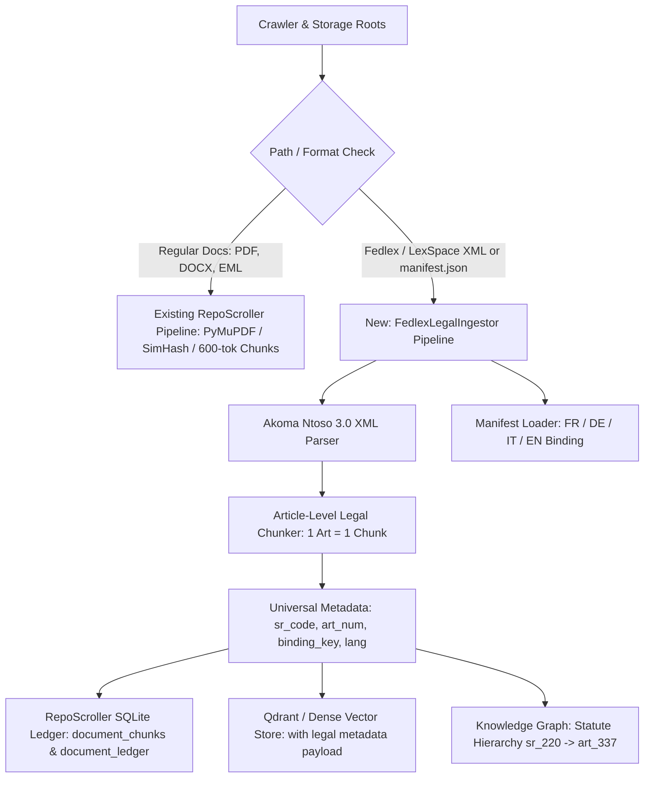

Listed directory SwissLexiBot_v2
Listed directory doc
Listed directory backend
Listed directory backend
Viewed ingestion_implementation_plan.md:1-181
Listed directory extraction
Listed directory core
Listed directory taxonomy
Listed directory ledger
Viewed config.py:1-150
Viewed ingest_fedlex.py:1-180
Viewed ingest_fedlex.py:300-450
Viewed ingest_fedlex.py:451-580
Viewed text_extractor.py:1-160
Viewed synchronizer.py:1-160
Viewed synchronizer.py:161-240
Searched for "CHUNK_SIZE_TOKENS"
Viewed chunker.py:1-78
Searched for "lexspace"
Searched for "legal"
Viewed analyzer.py:1-100
Viewed taxonomy.py:1-100
Viewed taxonomy.py:101-200
Viewed schema.py:1-100
Viewed schema.py:101-200
Viewed graph_extractor.py:1-120
Searched for "statute"
Viewed graph_extractor.py:320-380
Viewed graph_extractor.py:440-520
Viewed graph_extractor.py:521-600
Viewed rag_engine.py:1-140
Viewed rag_engine.py:141-260
Viewed crawler.py:1-100
Viewed qdrant_plugin.py:1-100
Viewed qdrant_plugin.py:101-145

### Executive Summary

The contrast between [SwissLexiBot_v2](file:///c:/Dev/SwissLexiBot_v2) and [RepoScroller](file:///c:/Dev/RepoScroller) stems from fundamentally different design philosophies:

1. **SwissLexiBot_v2** was engineered as a **specialized legal intelligence platform**. It treats the Swiss Federal Law repository ([LexSpace](file:///c:/Dev/SwissLexiBot_v2/backend/ingest_fedlex.py#L64)) as an authoritative, structured legal hierarchy based on the Swiss Systematic Compilation (*Recueil systématique / Systematische Rechtssammlung* — **SR/RS**). It ingests official **Akoma Ntoso 3.0 XML**, preserves legal article boundaries, binds multilingual versions (FR, DE, IT, EN) via deterministic keys, and enables zero-hallucination article lookups.
2. **RepoScroller** was built as a **generic file scavenger and ALCOA+ document ledger**. It was optimized for contracts, bank statements, invoices, and scans. It treats all files as flat blobs of text, ignores XML files completely, slices text into arbitrary 600-token sliding windows, and extracts statutes via simplistic regex heuristics capped at 5 matches per file.

Yes, **RepoScroller's ingestion mechanism can be upgraded** by porting the architectural patterns from SwissLexiBot_v2 into a dedicated **Legal/Fedlex Domain Pipeline**.

---

### Core Architectural Comparison

| Dimension | [SwissLexiBot_v2](file:///c:/Dev/SwissLexiBot_v2/backend/ingest_fedlex.py) | [RepoScroller](file:///c:/Dev/RepoScroller/backend) |
| :--- | :--- | :--- |
| **Source of Truth** | **Akoma Ntoso 3.0 XML** (`.xml` from Fedlex) — Tier 1 priority; PDFs are only reference attachments. | **Monolithic PDFs** (`.pdf`) — PyMuPDF dumps 500-page compiled law codes into raw text strings. |
| **File Extension Handling** | Natively parses `.xml`, `.json`, and binds associated `.pdf` files. | `SUPPORTED_EXTENSIONS = [".pdf", ".docx", ".txt", ".md", ".eml"]` — **ignores `.xml` entirely!** |
| **Ingestion Topology** | Manifest-driven: loads `manifest.json` mapping each SR code across languages to `{xml, pdf}`. | Flat filesystem crawler: crawls `STORAGE_ROOTS` blindly with no knowledge of Fedlex directory trees. |
| **Chunking Unit** | **Semantic Legal Article**: 1 chunk = 1 `<an:article>` with its `<an:num>`, `<an:heading>`, and paragraphs. | **Fixed Word Window**: [DocumentChunker](file:///c:/Dev/RepoScroller/backend/ai/chunker.py#L8-L77) slices text every 600 tokens (+80 overlap), chopping sentences and articles in half. |
| **Multilingual Alignment** | Deterministic `binding_key = f"{sr_code}_{article_num}"` binds FR, DE, IT, EN versions of the same article. | Disconnected: French PDF and German PDF get different SHA-256s and are treated as unrelated documents. |
| **Metadata Schema** | [MetadataBuilder](file:///c:/Dev/SwissLexiBot_v2/backend/ingest_fedlex.py#L76-L146): `sr_code`, `article_num`, `lang`, `title`, `short_form`, `article_heading`, `binding_key`. | Generic ledger: `doc_type = statute_legislation`, `canonical_filename`, `maturity_score`. |
| **Knowledge Graph Representation** | Hierarchical: SR Code $\to$ Book $\to$ Chapter $\to$ Article $\to$ Paragraph. | [graph_extractor.py](file:///c:/Dev/RepoScroller/backend/ai/graph_extractor.py#L537-L543): regex extracts up to 5 matches (`Art. 1`, `Art. 2`) as isolated, unanchored nodes. |
| **Retrieval Strategy** | **Dual Pipeline**: Exact metadata lookup for "Art. 320 CO" + Multilingual E5 dense vectors for semantic queries. | Pure vector similarity (Qdrant / SQLite) with no legal-code filtering. |

---

### The 5 Root Causes of RepoScroller's Current Limitations

#### 1. RepoScroller Completely Skips Official Legal XML

In [backend/config.py](file:///c:/Dev/RepoScroller/backend/config.py#L41-L43) and [crawler.py](file:///c:/Dev/RepoScroller/backend/core/crawler.py#L55-L56):

```python
SUPPORTED_EXTENSIONS = [".pdf", ".docx", ".txt", ".md", ".eml"]
```

When RepoScroller scans `\\SyNAS\CloudSpace\LexSpace`, it **drops all the Akoma Ntoso `.xml` files and `manifest.json`**. It only picks up compiled, hundreds-of-pages-long Fedlex PDFs (e.g. `fedlex-...-RS-220_...-fr-pdf-a.pdf`), which are designed for printing, not for structured machine ingestion.

#### 2. Arbitrary Token Slicing vs. Legal Article Units

In RepoScroller, [DocumentChunker](file:///c:/Dev/RepoScroller/backend/ai/chunker.py#L54-L75) splits text by word count:

```python
step = max(1, self.chunk_size - self.chunk_overlap)  # 600 tokens, 80 overlap
```

In a 600-token chunk of a 500-page Code of Obligations PDF:

- The beginning of Article 321a might be grouped with the end of Article 320.
- Marginal notes and headings (e.g., *"A. Conclusion du contrat / I. Forme"*) are stripped or separated from the article body.
- Citations lose their context.

In contrast, SwissLexiBot_v2's [parse_akoma_ntoso_xml](file:///c:/Dev/SwissLexiBot_v2/backend/ingest_fedlex.py#L429-L540) extracts:

```python
full_text = f"passage: {title} ({short_form} SR {sr_code}), {art_num} — {article_heading}: {text_content}"
```

Each vector embedding contains the full legal provenance.

#### 3. No Multilingual Binding Key (`binding_key`)

Under Swiss law, German, French, and Italian statutory texts are co-equal official versions.
SwissLexiBot_v2 solves cross-language mapping with a universal anchor:
$$\text{binding\_key} = \text{sr\_code} + \text{"\_"} + \text{article\_num} \quad (\text{e.g., } \texttt{"220\_Art. 1"})$$
Whether you query *Art. 1 CO* in French or *Art. 1 OR* in German, the system recognizes that both refer to the exact same legal norm.
RepoScroller has no concept of this: it hashes the German file into SHA-256 $A$ and the French file into SHA-256 $B$, leaving them as isolated silos.

#### 4. The Knowledge Graph Has No Legal Hierarchy

In [backend/ai/graph_extractor.py](file:///c:/Dev/RepoScroller/backend/ai/graph_extractor.py#L537-L543):

```python
# 4. Extract Legal Statutes (e.g. OR 253, Art. 320 OR, ZGB, StGB)
statute_matches = re.findall(r'\b(?:Art\.?\s*\d+\w*|\b[A-Z]{2,4}\b\s+Art\.?\s*\d+)', text, re.IGNORECASE)
for stat in set(statute_matches[:5]):
    st_id = canonicalize_node_id("statute", stat)
```

- It caps matches at 5 per document (`[:5]`), which misses almost everything in a 1,000-article code.
- It produces orphan node IDs like `statute_art_1` without specifying if it is the Civil Code, Code of Obligations, or Criminal Code.
- It cannot link an employment contract's clause citing "Art. 337 CO" to the actual statutory text of Article 337 in the Swiss Code of Obligations.

#### 5. Lack of Deterministic Retrieval

When a user asks: *"What does Art. 337 CO say regarding immediate dismissal?"*, dense vector models often retrieve adjacent articles (Art. 336 or 337a) because their embeddings are semantically similar.
SwissLexiBot_v2 implements **Deterministic Metadata Lookup** in [rag_engine.py](file:///c:/Dev/SwissLexiBot_v2/backend/rag_engine.py#L236-L260): it checks the query for statutory abbreviations (`CO` $\to$ `SR 220`, `337` $\to$ `Art. 337`), queries ChromaDB by exact metadata filter, and returns the exact article with 100% precision before running vector search.

---

### Step-by-Step Blueprint to Improve RepoScroller

To integrate SwissLexiBot_v2's legal precision into RepoScroller without compromising RepoScroller's ability to handle invoices, contracts, and scans, implement the following architectural enhancements:



#### Step 1: Update Configuration to Support Legal XML

In [backend/config.py](file:///c:/Dev/RepoScroller/backend/config.py):

1. Add `.xml` to `SUPPORTED_EXTENSIONS` (or conditionally enable it for legal storage roots).
2. Add a `SWISS_LAW_ROOTS` configuration entry pointing to `\\SyNAS\CloudSpace\LexSpace` and `\\SyNAS\xcloud\LawSuiteRAG`.
3. Port the `SWISS_LAW_MAP` dictionary (mapping `CO`/`OR` $\to$ `220`, `CC`/`ZGB` $\to$ `210`, `CPC`/`ZPO` $\to$ `272`, etc.) into `backend/config.py` or a dedicated legal module.

#### Step 2: Create a Dedicated `FedlexParser` Module

Create a new file: `backend/extraction/fedlex_parser.py`:

- Port `parse_akoma_ntoso_xml()` from SwissLexiBot_v2:
  - Parse `<an:article>` nodes.
  - Extract `<an:num>` (e.g. `Art. 337`) and `<an:heading>` (e.g. `Résiliation immédiate / Justes motifs`).
  - Extract all constituent `<an:p>` paragraphs.
- Port `load_manifest()` to parse `manifest.json` from the root of `LexSpace`.
- Attach `pdf_reference_path` so that RepoScroller points directly to the official PDF file on the NAS without needing to parse the PDF text.

#### Step 3: Implement Legal Unit Chunking (`LegalArticleChunker`)

Extend [backend/ai/chunker.py](file:///c:/Dev/RepoScroller/backend/ai/chunker.py) with a `chunk_legal_statute()` method:

- Keep the entire article together as a single chunk.
- Prepend standard contextual prefixes:

  ```text
  passage: Code des obligations (CO SR 220), Art. 337 — Résiliation immédiate / Pour de justes motifs: L'employeur et le travailleur peuvent résilier immédiatement le contrat en tout temps pour de justes motifs...
  ```

- If an article is unusually long (e.g. >1200 tokens), chunk by numbered paragraphs (*alinéas*), keeping the article header on each paragraph.

#### Step 4: Upgrade RepoScroller's Knowledge Graph Schema

In [backend/ai/graph_extractor.py](file:///c:/Dev/RepoScroller/backend/ai/graph_extractor.py) and [backend/ledger/schema.py](file:///c:/Dev/RepoScroller/backend/ledger/schema.py):

1. Create canonical **statute hierarchy nodes**:
   - Macro code: `statute_sr_220` (Code des obligations / Obligationenrecht).
   - Article node: `statute_sr_220_art_337`.
   - Directed relationship:
     $$(\texttt{statute\_sr\_220\_art\_337}) \xrightarrow{\texttt{PART\_OF}} (\texttt{statute\_sr\_220})$$
2. Multilingual alignment edges:
   $$(\texttt{statute\_sr\_220\_art\_337\_fr}) \xrightarrow{\texttt{TRANSLATION\_OF}} (\texttt{statute\_sr\_220\_art\_337})$$
3. When parsing general documents (like an employment contract or a court order in `theme_legal_justice`):
   - Replace the simplistic `re.findall(..., text)[:5]` with regex matching against the known `SWISS_LAW_MAP`.
   - When an employment contract mentions *"conformément à l'art. 337 CO"*, link the contract's SHA-256 directly to `statute_sr_220_art_337` with the role `GOVERNED_BY`!

#### Step 5: Implement Deterministic Article Lookup in Qdrant / Vector Store

In [backend/ledger/qdrant_plugin.py](file:///c:/Dev/RepoScroller/backend/ledger/qdrant_plugin.py):

- Include `sr_code`, `article_num`, `lang`, and `binding_key` in the payload of each Qdrant point.
- Create Qdrant payload indices on `sr_code`, `article_num`, and `binding_key`.
- In query handlers, when an article citation is detected, execute a **payload filter lookup** first, guaranteeing exact statutory text retrieval.

---

### Suggested Next Steps

1. **Phase 1 (Non-breaking Crawler & Parser Addition)**:
   Add `.xml` support to [config.py](file:///c:/Dev/RepoScroller/backend/config.py) and introduce `backend/extraction/fedlex_parser.py` using SwissLexiBot_v2's Akoma Ntoso parser.
2. **Phase 2 (Article-level Chunking & Ledger Ingestion)**:
   Update [synchronizer.py](file:///c:/Dev/RepoScroller/backend/core/synchronizer.py) to route `.xml` files through `fedlex_parser.py`, chunking by legal article into `document_chunks`.
3. **Phase 3 (Knowledge Graph & Cross-Document Binding)**:
   Wire statutory references in general documents (contracts, court judgments) to the canonical statute nodes in [graph_extractor.py](file:///c:/Dev/RepoScroller/backend/ai/graph_extractor.py).
