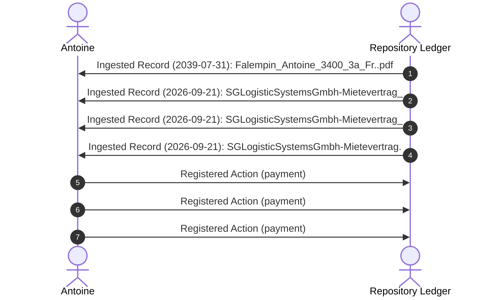

# Portrait & Relational Dynamics: Antoine Falempin

## 1. Executive Summary & Verified Profile
- **Primary Focus Entity:** `Antoine Falempin` (Classification: **Person**)
- **Date of Birth:** 1975-06-23 *(Source: Formblatt Falempin / Assura-Basis SA)*
- **Nationality:** France *(Source: Formblatt personal identification)*
- **Verified Residential Addresses:**
  - Eschenstrasse 7, 6312 Steinhausen (ZG)
  - Rebenstrasse 29b, 8913 Ottenbach (ZH)
- **Civil & Family Status:** Married / Verheiratet (with registered child allowance / Kinderabzug in Canton Zug)
- **Family & Dependents:**
  - Dinda Gayatri Ranadireksa (Helsana health policy insured / dependent)
  - Sylvie Napogui Catajou
- **Tax & Municipal ID:** Gemeinde Steinhausen (Pers ID: `1277-4634`, Kanton Zug)
- **Banking & Depository:** PostFinance Depot 97-105003-9
- **Professional Domain & Roles:** Senior Verification Test Engineer / Test Architect; Software Development & System Test Lead (Medical Devices / Biotech / R&D)
- **Core Network Interlocutors:**
  - `Kanton-Zug-Obergericht-Court` — Association: *PARTY_TO*
  - `Praxis Central Bahnhof GmbH` — Association: *PARTY_TO*
  - `Kanton-Zug-Kantonsgericht` — Association: *PARTY_TO*
  - `PB Group Holding AG` — Association: *PARTY_TO*
  - `People Business AG` — Association: *PARTY_TO*
  - `ERNI Consulting AG` — Association: *PARTY_TO*
  - `PASS Technologies AG` — Association: *PARTY_TO*
  - `O 2008 Xeronics AG` — Association: *PARTY_TO*
  - `Reliability Monitoring Xeronics AG` — Association: *PARTY_TO*
  - `Le present recu aetc` — Association: *PARTY_TO*
  - `Gute und weiterhin viel Erfolg. Xeronics AG` — Association: *PARTY_TO*
  - `Apropos de PASS Technologies AG` — Association: *PARTY_TO*

- **Network Telemetry:** 60 verified graph edges, 20 linked ledger records, 30 active obligations.

## 2. Relational Dynamics & Influence Hierarchy

```mermaid
graph TD
    Antoine_Falempin["★ Antoine Falempin"]
    Kanton_Zug_Obergericht_Court["Kanton-Zug-Obergericht-Court"]
    Antoine_Falempin -->|"PARTY_TO"| Kanton_Zug_Obergericht_Court
    Praxis_Central_Bahnhof_GmbH["Praxis Central Bahnhof GmbH"]
    Antoine_Falempin -->|"PARTY_TO"| Praxis_Central_Bahnhof_GmbH
    Kanton_Zug_Kantonsgericht["Kanton-Zug-Kantonsgericht"]
    Antoine_Falempin -->|"PARTY_TO"| Kanton_Zug_Kantonsgericht
    PB_Group_Holding_AG["PB Group Holding AG"]
    Antoine_Falempin -->|"PARTY_TO"| PB_Group_Holding_AG
    People_Business_AG["People Business AG"]
    Antoine_Falempin -->|"PARTY_TO"| People_Business_AG
    ERNI_Consulting_AG["ERNI Consulting AG"]
    Antoine_Falempin -->|"PARTY_TO"| ERNI_Consulting_AG
    PASS_Technologies_AG["PASS Technologies AG"]
    Antoine_Falempin -->|"PARTY_TO"| PASS_Technologies_AG
    O_2008_Xeronics_AG["O 2008 Xeronics AG"]
    Antoine_Falempin -->|"PARTY_TO"| O_2008_Xeronics_AG
    Reliability_Monitoring_Xeronics_AG["Reliability Monitoring Xeronics AG"]
    Antoine_Falempin -->|"PARTY_TO"| Reliability_Monitoring_Xeronics_AG
    Le_present_recu_aetc["Le present recu aetc"]
    Antoine_Falempin -->|"PARTY_TO"| Le_present_recu_aetc
    Gute_und_weiterhin_viel_Erfolg__Xeronics_AG["Gute und weiterhin viel Erfolg. Xeronics AG"]
    Antoine_Falempin -->|"PARTY_TO"| Gute_und_weiterhin_viel_Erfolg__Xeronics_AG
    Apropos_de_PASS_Technologies_AG["Apropos de PASS Technologies AG"]
    Antoine_Falempin -->|"PARTY_TO"| Apropos_de_PASS_Technologies_AG
    Produit_par_Xeronics_AG["Produit par Xeronics AG"]
    Antoine_Falempin -->|"PARTY_TO"| Produit_par_Xeronics_AG
    Xeronics_AG["Xeronics AG"]
    Antoine_Falempin -->|"PARTY_TO"| Xeronics_AG
    Visual_Basic_5_0__Schneider_Electric_SA["Visual Basic 5.0. Schneider Electric SA"]
    Antoine_Falempin -->|"PARTY_TO"| Visual_Basic_5_0__Schneider_Electric_SA
    System_Test_Center_PASS_Technologies_AG["System Test Center PASS Technologies AG"]
    Antoine_Falempin -->|"PARTY_TO"| System_Test_Center_PASS_Technologies_AG
    IT__01_2005___12_2007__PASSTechnologies_AG["IT. 01.2005 - 12.2007. PASSTechnologies AG"]
    Antoine_Falempin -->|"PARTY_TO"| IT__01_2005___12_2007__PASSTechnologies_AG
    Geschaftsfuhrer_PASSTechnologies_AG["Geschaftsfuhrer PASSTechnologies AG"]
    Antoine_Falempin -->|"PARTY_TO"| Geschaftsfuhrer_PASSTechnologies_AG
    Dieter_Speidel_PASSTechnologies_AG["Dieter Speidel PASSTechnologies AG"]
    Antoine_Falempin -->|"PARTY_TO"| Dieter_Speidel_PASSTechnologies_AG
    Geschaftsfuhrer_PASS_Technologies_AG["Geschaftsfuhrer PASS Technologies AG"]
    Antoine_Falempin -->|"PARTY_TO"| Geschaftsfuhrer_PASS_Technologies_AG
    classDef focus fill:#4f46e5,stroke:#818cf8,stroke-width:2px,color:#ffffff;
    classDef counterparty fill:#0f172a,stroke:#38bdf8,stroke-width:1px,color:#f8fafc;
    class Antoine_Falempin focus;
```

## 3. Structural Concerns & Friction Points
- **No Critical Bottlenecks:** No immediate overdue disputes detected in the current ledger slice.

## 4. Operational & Legal Risks
- **Risk Factor #1 (🟡 COMPLETED):** Pay invoice/bill (SGLogisticSystemsGmbh-Mietevertrag_Contract_PrintReady.pdf): 140.0 CHF *(Source: `SGLogisticSystemsGmbh-Mietevertrag_Contract_PrintReady.pdf`)*
- **Risk Factor #2 (🟡 PENDING):** Pay invoice/bill (2025-10-20_Gmail - Re_ documents financiers - Antoine Falempin.pdf): 10669.0 CHF *(Source: `2025-10-20_Gmail - Re_ documents financiers - Antoine Falempin.pdf`)*
- **Risk Factor #3 (🟡 COMPLETED):** Pay invoice/bill (2026-01-07_TO_Antoine Falempin~ML~Rechrung Objekt 236009473.md): 93.5 CHF *(Source: `2026-01-07_TO_Antoine Falempin~ML~Rechrung Objekt 236009473.md`)*
- **Risk Factor #4 (🟡 PENDING):** Sign and return document (2022-01-03_TO_Antoine Falempin~ML~Declaration de sinistre en cuisine AllianzT864350299.md) *(Source: `2022-01-03_TO_Antoine Falempin~ML~Declaration de sinistre en cuisine AllianzT864350299.md`)*
- **Risk Factor #5 (🟡 COMPLETED):** Pay invoice/bill (2026-09-20_SGLogisticSystemsGmbh-Mietevertrag.pdf): 140.0 CHF *(Source: `2026-09-20_SGLogisticSystemsGmbh-Mietevertrag.pdf`)*
- **Risk Factor #6 (🟡 PENDING):** Sign and return document (2019-06-27_75562_CCX_TVF__27.06.2019.pdf) *(Source: `2019-06-27_75562_CCX_TVF__27.06.2019.pdf`)*

## 5. Chronological Escalation / Sequence (if applicable)

